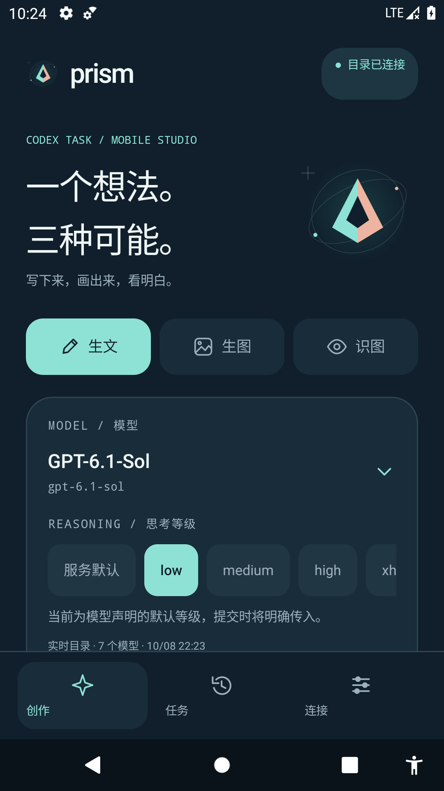
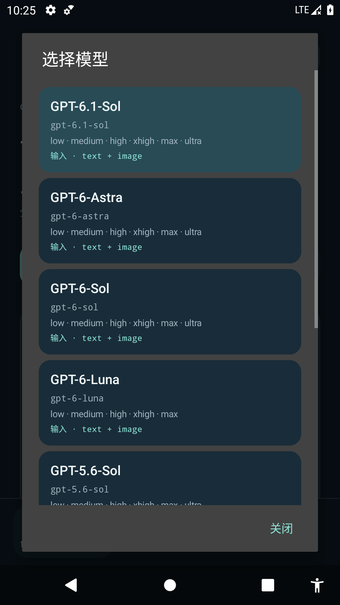

<div align="center">

# Prism Task

**一个想法。三种可能。**

A native Android studio for testing CodexTask — text, image generation, and image understanding.

[](https://github.com/wangyendt/prism-task/actions/workflows/android.yml)


[](LICENSE)

</div>

Prism Task 是 [CodexTask](https://github.com/wangyendt/codex-task) 的独立手机测试客户端。原生 Java 界面，深海蓝、冰青与珊瑚色，围绕模型选择、思考等级和异步任务设计，不把服务里的模型列表写死在 App 中。

## 界面

<!-- Screenshots are captured from the actual Android app, not a web mockup. -->
<p align="center">
  
  
</p>

## 功能

- **生文**：`POST /v1/text`，可附带参考图片。
- **生图**：`POST /v1/image`，支持参考图片、尺寸和质量选择；下载、保存与分享图片。
- **识图**：上传原始图片并调用 `/v1/text`，不把图片输入能力误当作生图能力。
- **动态目录**：`GET /v1/models` / `?refresh=true`，展示名称、ID、输入类型、服务来源、缓存状态和查询时间。
- **动态等级**：思考等级作为字符串、保留返回顺序；首次选择预选模型声明的默认等级；另有明确的“服务默认”选项。
- **选择保护**：目录刷新失败保留缓存；原模型或等级消失后提示重选，阻止无效组合，不静默替换。
- **手动 ID**：可测试目录尚未收录的模型，自定义等级可省略或显式输入，由服务最终校验。
- **任务记录**：最近 30 条请求与结果保存在本机，展示实际模型、实际思考等级及 Token 用量。
- **异步跟踪**：识别 `queued/running/completed/failed/cancelled/needs_input`，渐进重连、恢复查询、服务端取消；提交 POST 不自动重试，避免重复任务。
- **安全凭证**：Android Keystore AES-GCM 加密保存 Token，不嵌入源码或 APK；禁用备份、明文 HTTP、鉴权重定向及跨源产物下载。
- **界面预览**：无 Token 也可查看明确标注的演示目录；预览模式不创建任务，不伪装推理成功。

> 当前只使用 **Direct** 后端。`defaultReasoning` 是模型声明值，不是服务默认配置；选择“服务默认”会省略 `reasoning`。生图选择的是调用工具的**主模型**，不是底层绘图模型版本；托管工具没有披露具体版本。主模型可能被服务回退，应以结果的 `effectiveModel` 为准，包括被标记为 Responses Lite 的 Luna。目录不是所有模型的推理实测证明。

## 开始使用

1. 安装自行构建的 APK，进入 **连接**。
2. 填写包含反向代理前缀的完整 HTTPS Base URL。默认地址是 `https://wangye.xin/services/codex-task`，也可替换为自己的服务。
3. 输入该服务创建的设备 Token，点 **保存并连接**。App 和仓库不包含任何可用 Token。
4. 在 **创作** 页选择模式、模型、等级，填写提示词后提交。
5. 在 **任务** 页查看结果；生成的图片可保存到系统文件选择器指定的位置或通过系统分享。

设备凭证应在服务主机上创建，只开放需要的范围：

```bash
codex-task token create --name YOUR_DEVICE --allow text,image
# 丢失设备或不再使用时：
codex-task token revoke YOUR_DEVICE
```

不要把 Token 贴到 Issue、提交记录、截图或构建配置里。公开 APK 不附带个人凭证；安装者需配置自己的服务 Token。

### 缓存与恢复

- 进入页面发起普通目录查询，服务普通缓存为 5 分钟；手动刷新最短间隔 15 秒。
- `stale=true` 或本地缓存会明确标识；失败时保留目录与已选模型/等级。
- 目录按服务地址分别缓存，切换到另一个服务需要重新输入凭证。
- 轮询仅在 App 进程存活时运行，**不是持久后台服务**；Android 杀掉进程后，重新打开会恢复同一服务的未完成任务。
- 服务重启或任务超过保留期限可能返回 404/410。本机已下载结果仍在；服务通常保留任务/产物 24 小时。
- 任务历史包含提示词与结果，位于 App 私有目录但不是额外加密数据库。不要用测试客户端保存高度敏感内容；可在连接页清除记录。
- 输入图片是临时草稿，进程退出后不保证保留；单张上限 20 MiB、合计 50 MiB，JSON Base64 上传，不主动压缩。

## 构建

Android Studio，或安装 **JDK 21、Android SDK 36、Build Tools 36.0.0** 后：

```bash
# 配置 ANDROID_HOME，或在本机 local.properties 写入 sdk.dir
./gradlew testDebugUnitTest lintDebug assembleDebug
```

调试包：`app/build/outputs/apk/debug/app-debug.apk`，包名 `com.wayne.prismtask.debug`。

正式包（包名 `com.wayne.prismtask`）：

```bash
# 仅首次生成；.signing 已被 Git 忽略，请私密备份以便后续升级。
./scripts/create-release-key.sh
./gradlew testDebugUnitTest lintRelease assembleRelease
```

正式包：`app/build/outputs/apk/release/app-release.apk`。无签名配置时 Gradle 只生成 unsigned release 包；不要直接安装未签名包。仓库不包含 keystore 或密码。

最低 Android 8.0 / API 26，目标 API 36；没有本地原生库/ABI 限制。不需要照片库全量读取、存储或相机权限，图片通过系统文件选择器获得。

## 项目结构

```text
app/src/main/java/com/wayne/prismtask/
  Protocol.java       动态目录、选择校验、请求结构、前缀与同源路径保护
  Api.java            有界 HTTPS 传输、异步任务与产物接口、错误脱敏
  Payload.java        临时文件流式 Base64 请求，避免大图重复占用堆内存
  Vault.java          Android Keystore Token 加密存储
  PrismApp.java       目录缓存、状态、图片导入、任务轮询、本机记录
  MainActivity.java   原生创作 / 任务 / 连接 / 结果 UI
  Visuals.java        棱镜视觉、线性图标、轻量文本格式化
app/src/test/         协议及假传输测试，不访问真实服务或产生推理费用
```

- [协议与安全边界](docs/API.md)
- [设计说明](docs/DESIGN.md)
- [验证记录](docs/VALIDATION.md)

CI 自动执行单元测试、Lint、调试 APK 构建与轻量公开源码凭证检查。真实服务冒烟测试需要显式提供环境变量，不在 CI 中运行。

## License

MIT。独立客户端，不属于 OpenAI 官方 App。
